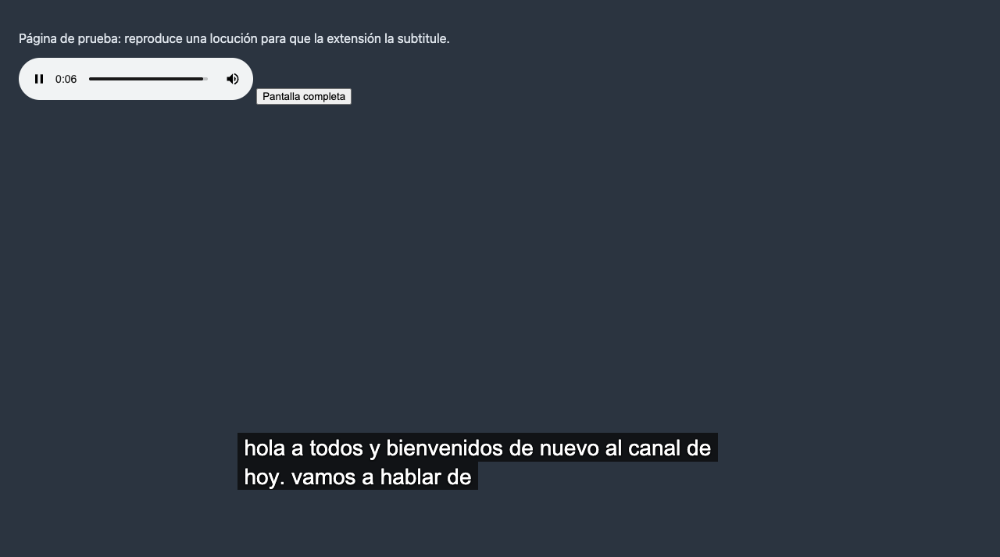

# Subtítulos traducidos en vivo

Extensión de Chrome que escucha el audio de la pestaña y muestra, en una barra
como la de los subtítulos automáticos de YouTube, su traducción en tiempo real
al idioma que elijas. Todo con modelos gratuitos y sin claves ni cuentas.



## Instalarla

Si has descargado el proyecto de GitHub, genera antes la carpeta
`extension/vendor` (el motor de Whisper, que pesa 27 MB y no se guarda en el
repositorio). Hace falta Node.js:

```bash
npm install
```

```bash
npm run vendor
```

Después:

1. Abre `chrome://extensions` en Chrome.
2. Activa **Modo de desarrollador** (arriba a la derecha).
3. Pulsa **Cargar descomprimida** y elige la carpeta `extension` de este proyecto.
4. Fija el icono de la extensión en la barra de herramientas para tenerlo a mano.

Si ya la tenías instalada y has actualizado los archivos, pulsa **Recargar** en
su tarjeta de `chrome://extensions`.

## Usarla

1. Abre una pestaña con un vídeo o un audio (YouTube, un directo, un pódcast…).
2. Pulsa el icono de la extensión y después **Subtitular esta pestaña**.
3. La primera vez se descarga el modelo de voz (entre 115 y 560 MB según el
   modelo). Queda guardado; las siguientes veces arranca en un par de segundos.
4. Aparece la barra sobre la página y empieza a mostrar la traducción.

### Cómo se escriben los subtítulos

Igual que los automáticos de YouTube:

- Las palabras aparecen **de una en una**, con una pequeña pausa entre ellas y
  un fundido breve, para que se distinga lo nuevo.
- El texto se escribe de izquierda a derecha en la línea de abajo. Cuando no
  cabe más, **la línea sube**, se abre otra debajo y la de arriba desaparece.
- **Lo ya escrito no se mueve ni se reescribe.** Una frase nueva empieza en
  línea nueva (salvo que la anterior apenas tenga texto).
- Tras unos segundos de silencio la barra se vacía.

Para conseguirlo solo se muestran las palabras que ya son estables: las que se
repiten igual en dos traducciones seguidas de la frase en curso, dejando
siempre en reserva las dos últimas, que son las que más cambian. Por eso van
entre uno y dos segundos por detrás de la voz.

El idioma del audio se detecta al empezar, solo entre los idiomas que ofrece
la extensión, y se mantiene mientras dure el vídeo. Así unas risas, unos
aplausos, una música o un acento marcado no lo cambian: Whisper tiende a "oír"
en ellos idiomas que nadie habla (en las pruebas tomó a un neozelandés por
hablante de maorí y unas risas por galés). Al pasar a otro vídeo o a otra
página se detecta de nuevo.

### La barra

- **Se mueve** arrastrando el texto con el ratón (o con las flechas del teclado
  si tiene el foco). Recuerda dónde la dejaste.
- Al pasar el ratón por el texto aparecen tres botones:
  - **Ventana flotante**: saca los subtítulos a una ventana siempre visible que
    puedes llevar a cualquier parte de la pantalla, también fuera de Chrome.
  - **Ajustes**: idioma de traducción, color del texto, fuente, tamaño y
    opacidad del fondo.
  - **Detener**.
- Sigue visible con el vídeo a pantalla completa.

En el popup del icono están los mismos ajustes y algunos más: idioma del audio
(por defecto se detecta solo), mostrar también el texto original, número de
líneas, modelo de voz y traductor.

Atajo de teclado para iniciar o detener: **Alt+Mayús+S** (⌥⇧S en Mac). Se puede
cambiar en `chrome://extensions/shortcuts`.

## Cómo funciona y qué sale de tu equipo

| Paso | Con qué | Dónde se ejecuta |
| --- | --- | --- |
| Captura del audio | API `tabCapture` de Chrome | En tu equipo |
| Voz a texto | Whisper (OpenAI, código abierto) con transformers.js | En tu equipo, en la tarjeta gráfica (WebGPU) o en el procesador |
| Traducción | Traductor integrado de Chrome (modelo local) | En tu equipo |
| Traducción de respaldo | Google Translate (servicio gratuito) | En línea: se envía el texto transcrito |

El audio nunca sale del equipo. El texto solo se envía a Google cuando el
traductor local de Chrome no puede con ese par de idiomas o aún no tiene el
paquete descargado. Si no quieres que salga nada, elige **Solo el traductor
local de Chrome** en *Más opciones → Traductor*.

### El traductor local hay que descargarlo una vez por idioma

Chrome trae algunos idiomas listos y el resto los descarga la primera vez, pero
solo tras un clic tuyo. Cuando haga falta, el popup lo dice y ofrece el botón
**Descargar el traductor local**.

Mientras tanto traduce Google, con dos salvedades: es un servicio de cortesía
que corta a quien le pregunta demasiado, así que la extensión le pregunta como
mucho una vez por segundo (los subtítulos van algo más a trompicones), y si aun
así se satura deja de preguntarle un rato. En ese caso la barra muestra lo que
se dice **sin traducir** y un aviso con el botón **Ver cómo arreglarlo**, que
abre el popup.

### Modelos de voz

| Opción | Modelo | Descarga | Para qué |
| --- | --- | --- | --- |
| Automático | *preciso* con gráfica Apple, NVIDIA o AMD; si no, *equilibrado* | | Valor por defecto |
| Rápido | whisper-tiny | ~115 MB | Equipos modestos |
| Equilibrado | whisper-base | ~200 MB | Uso general |
| Preciso | whisper-small | ~560 MB | Mejor transcripción; pide una gráfica decente |

## Limitaciones

- Los subtítulos van entre uno y dos segundos por detrás de la voz.
- Como lo escrito no se corrige, si el reconocimiento o la traducción cambian
  de idea a mitad de frase puede quedar alguna palabra suelta («de que es ha
  atraído»). En una medición sobre dos minutos y medio de un discurso real
  quedó suelta una palabra de cada cincuenta.
- Si dentro de un mismo vídeo se cambia de idioma hablado, la extensión tarda
  un par de frases en darse cuenta. Si sabes el idioma, fíjalo en el popup.
- En idiomas con otro orden de palabras (alemán, japonés…) la traducción de la
  frase cambia mucho mientras se habla y las palabras tienden a salir juntas al
  final de cada frase.
- Con música, ruido o varias personas hablando a la vez la transcripción empeora.
- Chrome no deja capturar sus páginas internas (`chrome://…`) ni la Chrome Web Store.
- Si la página pone a pantalla completa directamente el elemento de vídeo (y no
  un reproductor que lo contenga), la barra se ve pero no se puede arrastrar
  hasta salir de la pantalla completa.
- La ventana flotante solo está disponible en páginas `https`.
- Solo se subtitula una pestaña a la vez.

## Desarrollo

```bash
npm install          # dependencias de desarrollo
npm run vendor       # copia transformers.js y el runtime de ONNX a extension/vendor
npm run icons        # regenera los PNG del icono a partir de icon.svg
npm test             # pruebas unitarias
npm run test:e2e     # pruebas de extremo a extremo en Chrome (ver abajo)
```

Las pruebas de extremo a extremo abren Chrome sin ventana con un perfil nuevo,
cargan la extensión, reproducen una locución y comprueban lo que muestra la
barra. Necesitan `openssl` y conexión (descargan el modelo de voz, ~200 MB), y
la locución suena muy baja por los altavoces mientras duran. No tocan el
traductor de Google: sus peticiones se desvían a un servidor local que lo imita.

### Estructura

```
extension/
  manifest.json
  background.js          service worker: coordina popup, captura y barra
  offscreen.html/.js     captura el audio de la pestaña y lanza el flujo
  audio-worklet.js       trocea el audio en tramas de 100 ms a 16 kHz
  asr-worker.js          Whisper (voz a texto) y detección de idioma
  lib/
    segmenter.js         separa el audio en trozos de voz por las pausas
    pipeline.js          audio → texto → traducción, por frases
    word-stream.js       de las versiones de cada frase, las palabras ya estables
    translation-service.js, chrome-translator.js, google-translate.js
    langs.js, models.js, text.js
  content/overlay.js     la barra de subtítulos
  shared/rollup.js       líneas que suben y aparición palabra a palabra
  shared/config.js       idiomas, fuentes, ajustes por defecto y formulario
  popup/                 el popup del icono
  vendor/                transformers.js y runtime de ONNX (se genera con npm run vendor)
tests/
  unit/                  lógica pura (node --test)
  e2e/                   la extensión entera en Chrome (puppeteer)
```
